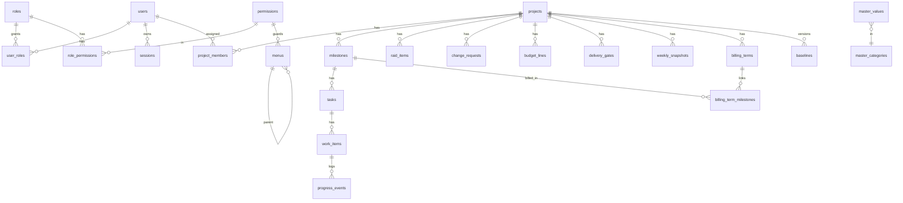

# PRD — PMO Project Control System (Web)

| Item             | Keterangan                                                                                                                    |
| ---------------- | ----------------------------------------------------------------------------------------------------------------------------- |
| Dokumen          | Product Requirements Document (PRD)                                                                                           |
| Versi            | 0.1 (draft awal)                                                                                                              |
| Tanggal          | 13 November 2026                                                                                                              |
| Pemilik produk   | PMO                                                                                                                           |
| Sumber kebutuhan | Workbook `PMO_Master_Integrated_60_Projects_with_Billing_Termin.xlsx` (+ sheet Project Timeline, Milestone Timeline, S-Curve) |
| Status           | Draft untuk review                                                                                                            |

---

## 1. Ringkasan

PMO saat ini mengelola portofolio project di satu workbook Excel. Workbook ini memiliki rantai progress Work Item → Task → Milestone → Project → Executive Dashboard, dan dilengkapi register RAID, Change Request, Budget, Delivery Gate, Weekly Snapshot, serta Billing Termin. Ada juga tampilan Gantt dan S-Curve per project.

Workbook bekerja dengan baik untuk simulasi. Namun, untuk operasional harian ada beberapa batasan: input dilakukan bersamaan oleh banyak PM, tidak ada kontrol akses, histori progress tidak tersimpan, dan formula mudah rusak.

Produk ini memindahkan seluruh logika workbook ke **aplikasi web berbasis PostgreSQL**. Aplikasi dilengkapi **login, user management, role & permission, serta menu dinamis**, dan semua kalkulasi (progress roll-up, RAG, overdue, billing readiness, S-Curve) dijalankan otomatis di server.

---

## 2. Latar Belakang & Masalah

| #   | Masalah di Excel saat ini                                                                                      | Dampak                                                                      |
| --- | -------------------------------------------------------------------------------------------------------------- | --------------------------------------------------------------------------- |
| P1  | Satu file dipakai banyak orang; update dikirim lewat file per PM lalu digabung manual (ada sheet _Import Log_) | Konflik versi, effort konsolidasi tinggi                                    |
| P2  | Tidak ada kontrol akses; semua orang bisa mengubah formula/data project lain                                   | Risiko data rusak, tidak ada akuntabilitas                                  |
| P3  | Progress hanya _nilai saat ini_. Weekly Snapshot masih berupa formula live sehingga histori ikut berubah       | S-Curve Actual tidak punya histori nyata                                    |
| P4  | Validasi bobot (harus 100%) hanya berupa panduan, tidak dipaksa                                                | Progress project bisa salah tanpa disadari                                  |
| P5  | Tidak ada tanggal aktual selesai pada Work Item/Task                                                           | Tidak bisa menghitung earned progress historis maupun deviasi jadwal aktual |
| P6  | Tidak ada audit trail (siapa mengubah apa, kapan)                                                              | Sulit ditelusuri saat ada dispute (mis. billing)                            |
| P7  | Kinerja dan ukuran file memburuk seiring bertambahnya project                                                  | Excel lambat, rawan korup                                                   |

---

## 3. Tujuan & Metrik Keberhasilan

**Tujuan**

1. Satu sumber data (_single source of truth_) untuk seluruh project portofolio.
2. Update progress cukup dilakukan di level Work Item, lalu semua level di atasnya ter-update otomatis.
3. Akses dikontrol per role dan per project.
4. Histori progress mingguan tersimpan permanen sehingga S-Curve Planned vs Actual akurat.
5. Dashboard eksekutif real-time tanpa konsolidasi manual.

**Metrik keberhasilan (6 bulan setelah go-live)**

| Metrik                                               | Target                                                 |
| ---------------------------------------------------- | ------------------------------------------------------ |
| Waktu konsolidasi laporan mingguan PMO               | turun ≥ 80% (dari konsolidasi manual menjadi otomatis) |
| Project aktif yang update progress setiap minggu     | ≥ 95%                                                  |
| Project dengan bobot milestone/task/work item = 100% | 100% (divalidasi sistem)                               |
| Snapshot mingguan otomatis terbentuk                 | 100% project aktif, setiap minggu                      |
| Waktu muat halaman dashboard (p95)                   | < 1,5 detik                                            |

---

## 4. Ruang Lingkup

### 4.1 In-scope (MVP + Fase 2)

- Login, logout, reset password, session management
- User management, role management, permission, menu management
- Master Data (list status, tipe, severity, portfolio, dll.)
- Project Register, Milestone, Task, Work Item, dengan roll-up progress otomatis
- RAID Register, Change Request, Budget Control, Delivery Gate
- Weekly Snapshot (otomatis + catatan manual PM)
- Billing Termin beserta relasi milestone dan evidence
- Project Timeline (Gantt), Milestone Timeline, S-Curve per project
- Executive Dashboard
- Import data awal dari Excel dan export ke Excel/CSV
- Audit trail

### 4.2 Out-of-scope (versi ini)

- Timesheet/effort tracking per orang
- Integrasi ERP/akuntansi untuk invoice (invoice tetap dicatat manual oleh Finance)
- Resource capacity planning lintas project
- Aplikasi mobile native (web dibuat responsif)
- Critical path / dependency antar-task (kandidat fase berikutnya)

---

## 5. Persona & Role

| Role                     | Deskripsi                                                                                     | Cakupan data                                |
| ------------------------ | --------------------------------------------------------------------------------------------- | ------------------------------------------- |
| **Super Admin**          | Mengelola sistem: user, role, menu, master data, konfigurasi                                  | Semua                                       |
| **PMO Admin**            | Kepala/lead PMO; membuat project, menetapkan PM, approve baseline, melihat seluruh portofolio | Semua project                               |
| **PMO Officer**          | Memantau, memvalidasi update, mengelola RAID/CR/gate lintas project                           | Semua project (edit terbatas)               |
| **Project Manager (PM)** | Mengelola milestone, task, work item, RAID, CR, snapshot untuk project miliknya               | Project yang di-assign                      |
| **PIC / Team Member**    | Mengubah status work item yang di-assign kepadanya dan mengunggah evidence                    | Work item miliknya                          |
| **Finance**              | Mengelola invoice & payment status pada Billing Termin, memverifikasi evidence billing        | Billing semua project                       |
| **Executive / Sponsor**  | Read-only: dashboard, timeline, S-Curve                                                       | Semua project, atau project yang disponsori |

> Role bersifat **dinamis**: Super Admin dapat membuat role baru dan mengatur permission serta menu tanpa perubahan kode. Tabel di atas adalah role _default_ hasil seeding.

---

## 6. Struktur Menu (default)

```
Dashboard
 └─ Executive Dashboard
Portofolio
 ├─ Project Register
 ├─ Project Detail  (tab: Overview · Milestone · Task · Work Item · RAID · CR · Budget · Gate · Billing · Snapshot)
 ├─ Project Timeline (Gantt)
 ├─ Milestone Timeline
 └─ S-Curve
Kontrol
 ├─ RAID Register
 ├─ Change Request
 ├─ Budget Control
 ├─ Delivery Gate
 └─ Weekly Snapshot
Billing
 └─ Billing Termin
Tugas Saya
 └─ My Work Items  (khusus PIC/PM)
Data
 ├─ Import Excel
 ├─ Import Log
 └─ Export
Administrasi
 ├─ User Management
 ├─ Role & Permission
 ├─ Menu Management
 ├─ Master Data
 ├─ Audit Trail
 └─ Pengaturan Sistem (threshold RAG, mapping status→%, jadwal snapshot)
```

Menu yang tampil di sidebar ditentukan oleh permission role user (lihat §7.3 dan §7.4).

---

## 7. Kebutuhan Fungsional

Penomoran: `FR-<modul>-<no>`. Prioritas: **M** = Must (MVP), **S** = Should (Fase 2), **C** = Could.

### 7.1 Autentikasi (AUTH)

| ID         | Kebutuhan                                                                                                                                                     | Prio |
| ---------- | ------------------------------------------------------------------------------------------------------------------------------------------------------------- | ---- |
| FR-AUTH-01 | Login dengan email/username + password                                                                                                                        | M    |
| FR-AUTH-02 | Password di-hash dengan algoritma kuat (scrypt bawaan Better Auth); kebijakan minimal 8 karakter, kombinasi huruf & angka                                     | M    |
| FR-AUTH-03 | Session berbasis cookie `HttpOnly`, `Secure`, `SameSite=Lax`; session disimpan di DB; idle timeout 30 menit dan absolute timeout 12 jam (dapat dikonfigurasi) | M    |
| FR-AUTH-04 | Logout menghapus session di server                                                                                                                            | M    |
| FR-AUTH-05 | Lupa password via email (token sekali pakai, berlaku 30 menit)                                                                                                | S    |
| FR-AUTH-06 | Paksa ganti password saat login pertama / setelah reset oleh admin                                                                                            | M    |
| FR-AUTH-07 | Kunci akun sementara setelah 5 kali gagal login dalam 15 menit; rate-limit endpoint login                                                                     | M    |
| FR-AUTH-08 | Halaman "Profil Saya": ganti password, nama, foto                                                                                                             | M    |
| FR-AUTH-09 | Lihat & cabut session aktif milik sendiri                                                                                                                     | S    |
| FR-AUTH-10 | SSO (Google Workspace / Microsoft Entra ID via OIDC)                                                                                                          | C    |
| FR-AUTH-11 | 2FA TOTP untuk role admin                                                                                                                                     | C    |

### 7.2 User Management (USER)

| ID         | Kebutuhan                                                                                                                     | Prio |
| ---------- | ----------------------------------------------------------------------------------------------------------------------------- | ---- |
| FR-USER-01 | CRUD user: nama, email, username, jabatan, unit, no. HP, status (Active/Inactive/Locked)                                      | M    |
| FR-USER-02 | Satu user dapat memiliki ≥1 role                                                                                              | M    |
| FR-USER-03 | Assign user ke project dengan peran project (PM, PIC, Sponsor, Viewer). Peran ini menentukan cakupan data (_row-level scope_) | M    |
| FR-USER-04 | Reset password oleh admin (menghasilkan password sementara + paksa ganti)                                                     | M    |
| FR-USER-05 | Nonaktifkan user tanpa menghapus histori; user nonaktif tidak bisa login                                                      | M    |
| FR-USER-06 | Pencarian, filter (role, status, unit), dan paginasi                                                                          | M    |
| FR-USER-07 | Import user massal via CSV                                                                                                    | S    |

### 7.3 Role & Permission (ROLE)

| ID         | Kebutuhan                                                                                                                                                      | Prio |
| ---------- | -------------------------------------------------------------------------------------------------------------------------------------------------------------- | ---- |
| FR-ROLE-01 | CRUD role (nama, deskripsi, status)                                                                                                                            | M    |
| FR-ROLE-02 | Permission granular per **resource × action**: `view`, `create`, `update`, `delete`, `approve`, `export`, `import` (mis. `project.update`, `billing.approve`)  | M    |
| FR-ROLE-03 | Atribut **scope** per permission: `all` (semua project) atau `assigned` (hanya project yang di-assign)                                                         | M    |
| FR-ROLE-04 | Matriks permission (checkbox grid) di UI untuk mengatur role                                                                                                   | M    |
| FR-ROLE-05 | Role sistem (Super Admin) tidak dapat dihapus atau dikurangi permission-nya                                                                                    | M    |
| FR-ROLE-06 | Permission dicek di **server** (middleware/guard) untuk setiap endpoint, bukan hanya disembunyikan di UI                                                       | M    |
| FR-ROLE-07 | Field-level restriction: mis. PM tidak bisa mengubah _Baseline Start/Finish_ setelah baseline dikunci; hanya Finance yang bisa mengubah Invoice/Payment Status | S    |

### 7.4 Menu Management (MENU)

| ID         | Kebutuhan                                                                                                 | Prio |
| ---------- | --------------------------------------------------------------------------------------------------------- | ---- |
| FR-MENU-01 | CRUD menu: label, ikon, route/URL, parent (hierarki 2 level), urutan, status aktif                        | M    |
| FR-MENU-02 | Setiap menu dikaitkan ke satu permission `view`; menu hanya tampil bila user memiliki permission tersebut | M    |
| FR-MENU-03 | Drag-and-drop untuk mengurutkan menu                                                                      | S    |
| FR-MENU-04 | Menu dimuat sekali saat login dan di-cache per role; cache di-invalidasi saat menu/role berubah           | M    |
| FR-MENU-05 | Akses langsung ke URL tanpa permission menghasilkan halaman 403                                           | M    |

### 7.5 Master Data (MD)

Nilai default diambil dari sheet _Master Data_ dan validasi di workbook:

| List                                 | Nilai default                                                                        |
| ------------------------------------ | ------------------------------------------------------------------------------------ |
| Work Item Status                     | Not Started, In Progress, Completed                                                  |
| RAID Type                            | Risk, Assumption, Issue, Dependency                                                  |
| RAID Severity / Impact / Probability | Low, Medium, High, Critical                                                          |
| RAID Status                          | Open, In Progress, Closed                                                            |
| RAG Status                           | Green, Amber, Red                                                                    |
| Portfolio                            | Digital Transformation, Infrastructure, Application, Cybersecurity, Data & Analytics |
| CR Priority / Impact Scope           | Low, Medium, High                                                                    |
| CR Status                            | Draft, Under Review, Approved, Rejected                                              |
| CR Decision                          | Pending, Approved, Rejected                                                          |
| Delivery Gate Name                   | Project Initiation, Design Approval, Build Complete, UAT Sign-off, Go-Live Approval  |
| Delivery Gate Status                 | Planned, In Progress, Approved                                                       |
| Invoice Status                       | Draft, Issued, Cancelled                                                             |
| Payment Status                       | Unpaid, Partially Paid, Paid, Overdue                                                |
| Evidence Verification Status         | Not Checked, Verified, Rejected                                                      |
| Cost Category                        | Project Cost (dapat ditambah)                                                        |
| Currency                             | IDR                                                                                  |

| ID       | Kebutuhan                                                                                     | Prio |
| -------- | --------------------------------------------------------------------------------------------- | ---- |
| FR-MD-01 | CRUD nilai master per kategori; nilai yang sudah dipakai tidak dapat dihapus (hanya nonaktif) | M    |
| FR-MD-02 | Nilai bersifat _system_ (dipakai logika, mis. "Completed") ditandai dan tidak bisa di-rename  | M    |

### 7.6 Project Register (PRJ)

Field (dari sheet _Project Register_): Project ID, Project Name, Project Manager, Sponsor, Portfolio, Baseline Start, Baseline Finish, Project Status*, Overall Progress %_, Planned Progress %_, Variance %_, RAG Status_, Milestone Count*, Open High/Critical RAID*, Overdue Milestones*, Last Update*, Notes. (*) = dihitung sistem.

Tambahan untuk sistem: Customer, Nilai Kontrak, Forecast Start/Finish, Actual Start/Finish, Baseline Locked (bool), Status Lifecycle (Draft, Active, On Hold, Closed, Cancelled).

| ID        | Kebutuhan                                                                                                                                                      | Prio |
| --------- | -------------------------------------------------------------------------------------------------------------------------------------------------------------- | ---- |
| FR-PRJ-01 | CRUD project; Project ID dibuat otomatis (`PRJ-###`) atau manual unik                                                                                          | M    |
| FR-PRJ-02 | List project dengan filter (portfolio, PM, RAG, status, sponsor), pencarian, sort, paginasi, dan badge RAG berwarna                                            | M    |
| FR-PRJ-03 | Halaman detail project dengan tab: Overview, Milestone, Task, Work Item, RAID, CR, Budget, Gate, Billing, Snapshot, Timeline, S-Curve                          | M    |
| FR-PRJ-04 | **Kunci baseline**: setelah dikunci, perubahan tanggal baseline hanya lewat Change Request yang Approved; sistem menyimpan versi baseline (rebaseline history) | S    |
| FR-PRJ-05 | Indikator kelengkapan bobot: peringatan jika total bobot milestone ≠ 100%                                                                                      | M    |
| FR-PRJ-06 | Clone struktur project dari template (milestone + task + work item standar)                                                                                    | S    |

### 7.7 Milestone (MS)

Field: Milestone ID, Project, Milestone Name, Milestone Weight %, Planned Start, Planned Finish, Milestone Status*, Progress %_, Weighted Contribution_, Owner, Acceptance Criteria, Evidence/Link, Notes. Tambahan: Actual Finish (otomatis saat progress mencapai 100%), Sequence.

| ID       | Kebutuhan                                                                                                                                | Prio |
| -------- | ---------------------------------------------------------------------------------------------------------------------------------------- | ---- |
| FR-MS-01 | CRUD milestone di dalam project; ID otomatis `<ProjectID>-M<n>`                                                                          | M    |
| FR-MS-02 | Validasi: Planned Finish ≥ Planned Start; Σ bobot milestone per project = 100% (toleransi ±0,01%) sebelum project boleh berstatus Active | M    |
| FR-MS-03 | Tombol "bagi rata bobot"                                                                                                                 | S    |
| FR-MS-04 | Upload/tautan evidence acceptance                                                                                                        | M    |

### 7.8 Task (TSK)

Field: Task ID, Project, Milestone, Task Name, Task Weight %, Owner, Planned Start, Planned Finish, Task Status*, Progress %_, Weighted Contribution_, Acceptance Criteria, Notes. Tambahan: Actual Start, Actual Finish.

| ID        | Kebutuhan                                              | Prio |
| --------- | ------------------------------------------------------ | ---- |
| FR-TSK-01 | CRUD task di bawah milestone; ID `<MilestoneID>-T<n>`  | M    |
| FR-TSK-02 | Validasi Σ bobot task per milestone = 100%             | M    |
| FR-TSK-03 | Peringatan bila tanggal task di luar rentang milestone | S    |
| FR-TSK-04 | Edit inline (grid) untuk tanggal & bobot               | S    |

### 7.9 Work Item (WI) — titik input progress

Field: Work Item ID, Project, Milestone, Task, Work Item Detail, Item Weight %, Status, Progress %_, Weighted Contribution_, PIC, Due Date, Evidence/Link, Last Update, Notes. Tambahan: **Completed At** (timestamp otomatis saat status menjadi Completed), **Started At**.

| ID       | Kebutuhan                                                                                                                                                                 | Prio |
| -------- | ------------------------------------------------------------------------------------------------------------------------------------------------------------------------- | ---- |
| FR-WI-01 | CRUD work item di bawah task; ID `<TaskID>-W<n>`                                                                                                                          | M    |
| FR-WI-02 | **Satu-satunya input progress**: user mengubah Status → Progress % mengikuti mapping (default Not Started = 0%, In Progress = 50%, Completed = 100%; dapat dikonfigurasi) | M    |
| FR-WI-03 | Validasi Σ bobot work item per task = 100%                                                                                                                                | M    |
| FR-WI-04 | Halaman **My Work Items** untuk PIC: daftar work item miliknya, update status massal, upload evidence                                                                     | M    |
| FR-WI-05 | Status Completed dapat diwajibkan menyertakan evidence (konfigurasi per project)                                                                                          | S    |
| FR-WI-06 | Setiap perubahan status dicatat ke `progress_event` (siapa, kapan, dari→ke). Data ini menjadi dasar histori S-Curve Actual                                                | M    |

### 7.10 Progress Engine (ENG)

| ID        | Kebutuhan                                                                                                                                                               | Prio |
| --------- | ----------------------------------------------------------------------------------------------------------------------------------------------------------------------- | ---- |
| FR-ENG-01 | Setiap perubahan pada work item, task, atau milestone memicu kalkulasi ulang roll-up dalam satu transaksi DB                                                            | M    |
| FR-ENG-02 | Hasil kalkulasi disimpan di kolom terhitung (denormalisasi) agar list & dashboard cepat; kalkulasi bersifat idempoten dan bisa dijalankan ulang (`recalculate project`) | M    |
| FR-ENG-03 | Nilai berbasis waktu (Planned Progress, RAG, Overdue) dihitung ulang setiap malam oleh scheduled job (00:30 WIB), karena nilainya bergantung pada tanggal hari ini      | M    |

Rumus detail ada di §8.

### 7.11 RAID Register (RAID)

Field: RAID ID, Project, Type, Description, Impact, Probability, Severity, Owner, Target Date, Status, Mitigation/Action, Last Update.

| ID         | Kebutuhan                                                                                                            | Prio |
| ---------- | -------------------------------------------------------------------------------------------------------------------- | ---- |
| FR-RAID-01 | CRUD RAID per project dan tampilan lintas project                                                                    | M    |
| FR-RAID-02 | Severity dapat dihitung otomatis dari matriks Impact × Probability (opsional, dapat dikonfigurasi) atau diisi manual | S    |
| FR-RAID-03 | Penanda overdue: Target Date < hari ini dan Status ≠ Closed                                                          | M    |
| FR-RAID-04 | Riwayat komentar/aksi per item RAID                                                                                  | S    |

### 7.12 Change Request (CR)

Field: CR ID, Project, Request Date, Requested By, Change Description, Impact Scope, Impact Schedule (Days), Impact Cost, Priority, Status, Decision, Approver, Decision Date.

| ID       | Kebutuhan                                                                                                 | Prio |
| -------- | --------------------------------------------------------------------------------------------------------- | ---- |
| FR-CR-01 | CRUD CR dengan workflow: Draft → Under Review → Approved/Rejected                                         | M    |
| FR-CR-02 | Hanya user dengan permission `cr.approve` yang dapat menyetujui; Decision Date & Approver terisi otomatis | M    |
| FR-CR-03 | CR Approved dengan dampak jadwal dapat memicu rebaseline (menautkan ke FR-PRJ-04)                         | S    |
| FR-CR-04 | CR Approved dengan dampak biaya dapat memperbarui Forecast Cost di Budget (dengan konfirmasi)             | S    |

### 7.13 Budget Control (BUD)

Field: Budget ID, Project, Cost Category, Approved Budget, Actual Cost, Forecast Cost, Variance* (= Approved − Forecast), Currency, Last Update, Notes.

| ID        | Kebutuhan                                                                           | Prio |
| --------- | ----------------------------------------------------------------------------------- | ---- |
| FR-BUD-01 | CRUD baris budget per kategori biaya per project                                    | M    |
| FR-BUD-02 | Ringkasan per project & portofolio: Approved, Actual, Forecast, Variance, % serapan | M    |
| FR-BUD-03 | Histori perubahan Actual/Forecast per periode (bulanan)                             | S    |

### 7.14 Delivery Gate (GATE)

Field: Gate ID, Project, Gate Name, Planned Date, Actual Date, Gate Status, Approval By, Evidence/Link, Notes.

| ID         | Kebutuhan                                                                                          | Prio |
| ---------- | -------------------------------------------------------------------------------------------------- | ---- |
| FR-GATE-01 | Gate standar (5 gate) otomatis dibuat saat project dibuat dari template                            | M    |
| FR-GATE-02 | Approval gate oleh user yang ditunjuk; Actual Date otomatis terisi saat Approved                   | M    |
| FR-GATE-03 | Gate Health: Approved / Overdue (Planned < hari ini dan belum Approved) / Due ≤ 14 hari / On Track | M    |

### 7.15 Weekly Snapshot (SNAP)

Field: Snapshot ID, Project, Week Ending, Overall Progress %, RAG Status, Completed This Week, Next Week Plan, Key Issue, Updated By, Update Date.

| ID         | Kebutuhan                                                                                                                                                                                             | Prio |
| ---------- | ----------------------------------------------------------------------------------------------------------------------------------------------------------------------------------------------------- | ---- |
| FR-SNAP-01 | Job otomatis setiap **Jumat 23:59 WIB** (dapat dikonfigurasi) membuat snapshot untuk semua project aktif: Overall Progress, Planned Progress, RAG, Variance. Nilai **dibekukan** (tidak berubah lagi) | M    |
| FR-SNAP-02 | PM mengisi narasi (Completed This Week, Next Week Plan, Key Issue) pada snapshot minggu berjalan sebelum cut-off                                                                                      | M    |
| FR-SNAP-03 | Snapshot yang sudah ditutup bersifat read-only; koreksi hanya oleh PMO Admin dengan alasan (tercatat di audit)                                                                                        | M    |
| FR-SNAP-04 | Pengingat ke PM yang belum mengisi narasi pada H-1 cut-off                                                                                                                                            | S    |

### 7.16 Billing Termin (BILL)

Struktur workbook: tabel termin (header) dan tabel relasi termin ↔ milestone dengan evidence per milestone.

Termin: Term ID, Project, Customer, Termin/Billing Stage, Billing Description, Termin Amount (IDR), Planned Billing Date, Actual Invoice Date, Linked Milestone Count*, Completed Milestone Count*, Evidence Complete Count*, Billing Readiness*, Invoice Number, Invoice Evidence URL/Path, Invoice Status, Payment Status.

Relasi: Term ID, Milestone ID, Milestone Name*, Milestone Status*, Milestone Acceptance Evidence URL/Path, Evidence Type/Document Ref, Evidence Date, Verified By, Evidence Verification Status.

| ID         | Kebutuhan                                                                                                         | Prio |
| ---------- | ----------------------------------------------------------------------------------------------------------------- | ---- |
| FR-BILL-01 | CRUD termin per project; satu termin dapat ditautkan ke ≥1 milestone dari project yang sama                       | M    |
| FR-BILL-02 | Upload evidence penerimaan per milestone (BAST, berita acara, UAT sign-off, acceptance certificate)               | M    |
| FR-BILL-03 | Verifikasi evidence (Verified/Rejected + catatan) oleh role yang berwenang; Verified By & tanggal terisi otomatis | M    |
| FR-BILL-04 | Billing Readiness otomatis (rumus §8.6)                                                                           | M    |
| FR-BILL-05 | Invoice Number, Invoice Evidence, Invoice Status, Payment Status hanya dapat diubah oleh Finance                  | M    |
| FR-BILL-06 | Validasi: Σ Termin Amount per project ≤ Nilai Kontrak (peringatan)                                                | S    |
| FR-BILL-07 | Ringkasan billing: nilai Ready to Bill, Issued, Paid, Outstanding per project/portofolio                          | M    |
| FR-BILL-08 | Status pembayaran **tidak** mempengaruhi progress project                                                         | M    |

### 7.17 Project Timeline / Gantt (GANTT)

| ID          | Kebutuhan                                                                                               | Prio |
| ----------- | ------------------------------------------------------------------------------------------------------- | ---- |
| FR-GANTT-01 | Pilih project → tampil baris ringkasan project + task dikelompokkan per milestone                       | M    |
| FR-GANTT-02 | Bar Planned Start–Finish; isi bar sebanding Progress %; bar merah bila lewat finish dan progress < 100% | M    |
| FR-GANTT-03 | Garis "hari ini"; zoom skala hari/minggu/bulan                                                          | M    |
| FR-GANTT-04 | Kolom: Milestone, Task, Owner, Start, Finish, Durasi, Bobot efektif terhadap project, Progress, Status  | M    |
| FR-GANTT-05 | Expand/collapse per milestone; drill-down ke work item                                                  | S    |
| FR-GANTT-06 | Tampilkan baseline vs forecast (dua bar) bila ada rebaseline                                            | S    |
| FR-GANTT-07 | Export PNG/PDF                                                                                          | S    |

### 7.18 Milestone Timeline (MTL)

| ID        | Kebutuhan                                                                                                             | Prio |
| --------- | --------------------------------------------------------------------------------------------------------------------- | ---- |
| FR-MTL-01 | Daftar milestone project dengan bar timeline dan penanda ◆ pada Planned Finish                                        | M    |
| FR-MTL-02 | Kolom: Bobot, Start, Finish, Progress, Status, **Schedule Health** (§8.5), sisa hari ke finish, jumlah termin terkait | M    |
| FR-MTL-03 | Overlay penanda Delivery Gate (▲) dan Planned Billing Date termin (●) di sumbu waktu yang sama                        | M    |
| FR-MTL-04 | Tampilan portofolio: semua milestone lintas project dalam rentang tanggal tertentu (mis. 30 hari ke depan)            | S    |

### 7.19 S-Curve (SC)

| ID       | Kebutuhan                                                                                                                              | Prio |
| -------- | -------------------------------------------------------------------------------------------------------------------------------------- | ---- |
| FR-SC-01 | Pilih project → grafik kumulatif Planned vs Actual per minggu                                                                          | M    |
| FR-SC-02 | Planned dihitung dari distribusi bobot efektif task secara linear antara Planned Start–Finish (§8.7)                                   | M    |
| FR-SC-03 | Actual diambil dari snapshot mingguan yang dibekukan; minggu berjalan memakai progress live; minggu pertama = 0%                       | M    |
| FR-SC-04 | Opsi rekonstruksi Actual historis dari `progress_event` (berguna untuk data awal hasil migrasi)                                        | S    |
| FR-SC-05 | KPI: Planned hari ini, Actual hari ini, Deviasi, SPI (= Actual/Planned), minggu ke-n; warna SPI: < 0,9 merah, 0,9–<1 kuning, ≥ 1 hijau | M    |
| FR-SC-06 | Tabel mingguan: Week Start, Week End, Planned kumulatif, Actual kumulatif, Deviasi, Planned per minggu                                 | M    |
| FR-SC-07 | S-Curve agregat portofolio (bobot per nilai kontrak atau per project, dapat dipilih)                                                   | C    |

### 7.20 Executive Dashboard (DASH)

Isi mengikuti sheet _Executive Dashboard_:

| ID         | Kebutuhan                                                                                                                                                                                                           | Prio |
| ---------- | ------------------------------------------------------------------------------------------------------------------------------------------------------------------------------------------------------------------- | ---- |
| FR-DASH-01 | KPI tiles: Total Projects, Active, Completed, Average Overall Progress, Green/Amber/Red Projects, Open High/Critical RAID, Overdue Milestones, Total Approved Budget, Total Forecast Cost, Budget Forecast Variance | M    |
| FR-DASH-02 | Portfolio Summary: jumlah project & rata-rata progress per Portfolio                                                                                                                                                | M    |
| FR-DASH-03 | RAG Summary (donut) dan progress per portfolio (bar)                                                                                                                                                                | M    |
| FR-DASH-04 | Daftar "Perlu Perhatian": project Red, milestone overdue, RAID critical, termin Ready to Bill belum di-invoice                                                                                                      | M    |
| FR-DASH-05 | Filter global: portfolio, PM, sponsor; klik KPI untuk drill-down ke list terfilter                                                                                                                                  | M    |
| FR-DASH-06 | Ringkasan billing portofolio                                                                                                                                                                                        | S    |
| FR-DASH-07 | Tren mingguan (dari snapshot): rata-rata progress dan jumlah project Red                                                                                                                                            | S    |

### 7.21 Import / Export (IMP)

| ID        | Kebutuhan                                                                                                                                              | Prio |
| --------- | ------------------------------------------------------------------------------------------------------------------------------------------------------ | ---- |
| FR-IMP-01 | **Import awal** dari workbook Excel master (semua sheet register) dengan pemetaan kolom sesuai §11                                                     | M    |
| FR-IMP-02 | Import update per project dari template Excel PM (menggantikan alur file per PM)                                                                       | S    |
| FR-IMP-03 | Validasi sebelum commit: ID unik, referensi induk valid, total bobot = 100%, format tanggal, nilai master valid. Tampilkan preview baris valid/invalid | M    |
| FR-IMP-04 | Setiap import dicatat di **Import Log**: File Name, Project ID, PM Name, Import Date, Validation Status, Issue/Notes, user, jumlah baris               | M    |
| FR-IMP-05 | Export setiap list ke Excel/CSV sesuai filter dan permission `export`                                                                                  | M    |
| FR-IMP-06 | Export laporan project (PDF): ringkasan, Gantt, milestone, S-Curve, RAID top-5                                                                         | S    |

### 7.22 Notifikasi (NOTIF) — Fase 2

| ID          | Kebutuhan                                                                                                             | Prio |
| ----------- | --------------------------------------------------------------------------------------------------------------------- | ---- |
| FR-NOTIF-01 | Notifikasi in-app: assignment work item, CR perlu approval, evidence perlu verifikasi, milestone jatuh tempo ≤ 7 hari | S    |
| FR-NOTIF-02 | Email digest mingguan untuk PM & PMO                                                                                  | S    |

### 7.23 Audit Trail (AUD)

| ID        | Kebutuhan                                                                                          | Prio |
| --------- | -------------------------------------------------------------------------------------------------- | ---- |
| FR-AUD-01 | Catat setiap create/update/delete: user, waktu, entitas, ID, nilai sebelum/sesudah (JSON diff), IP | M    |
| FR-AUD-02 | Catat event keamanan: login sukses/gagal, logout, reset password, perubahan role/permission        | M    |
| FR-AUD-03 | Halaman audit dengan filter user, entitas, tanggal; tab "History" di setiap record                 | M    |
| FR-AUD-04 | Audit bersifat append-only (tidak dapat diubah/dihapus via aplikasi)                               | M    |

---

## 8. Aturan Bisnis & Rumus (diturunkan dari workbook)

### 8.1 Progress Work Item

```
progress_wi = mapping[status]      -- default: Not Started 0, In Progress 0.5, Completed 1
weighted_wi = weight_wi × progress_wi
```

### 8.2 Roll-up (weighted average)

```
progress_task      = Σ weighted_wi (task)  / Σ weight_wi (task)
progress_milestone = Σ (weight_task × progress_task) / Σ weight_task (milestone)
overall_progress   = Σ (weight_ms × progress_ms)     / Σ weight_ms (project)
```

- Penyebut 0 → progress = 0.
- Status turunan (Task/Milestone/Project): `≥ 100% → Completed`, `= 0% → Not Started`, selain itu `In Progress`.
- Bobot efektif task terhadap project (untuk Gantt & S-Curve):
  `eff_task = (weight_task / Σ weight_task_in_ms) × (weight_ms / Σ weight_ms_in_project)`

### 8.3 Planned Progress (berbasis waktu) & RAG

```
planned_progress = 1                                       jika baseline_finish ≤ baseline_start
                 = clamp((today − baseline_start) / (baseline_finish − baseline_start), 0, 1)
variance         = overall_progress − planned_progress
RAG = Green  jika variance ≥ −10%
      Amber  jika variance ≥ −20%
      Red    selainnya
```

Threshold −10% / −20% disimpan di Pengaturan Sistem.

### 8.4 Indikator Project

- **Milestone Count** = jumlah milestone project.
- **Overdue Milestones** = jumlah milestone dengan `planned_finish < today` dan `progress < 100%`.
- **Open High/Critical RAID** = jumlah RAID dengan `severity ∈ {High, Critical}` dan `status ≠ Closed`.
- **Budget Variance** = `approved_budget − forecast_cost`.

### 8.5 Schedule Health Milestone

Dievaluasi berurutan; kondisi pertama yang terpenuhi dipakai:

1. `progress ≥ 100%` → **Completed**
2. `planned_finish < today` → **Overdue**
3. `planned_start ≤ today` dan `progress < min(1, (today − start + 1)/(finish − start + 1)) − 20%` → **At Risk**
4. `planned_finish − today ≤ 14 hari` → **Due ≤ 14 hari**
5. `planned_start > today` → **Not Started**
6. selainnya → **On Track**

Health di level project: Completed jika progress 100%; Overdue jika ada milestone Overdue; At Risk jika ada milestone At Risk; selainnya On Track.

### 8.6 Billing Readiness (per termin)

```
linked    = jumlah milestone tertaut
completed = jumlah milestone tertaut berstatus Completed
evidence  = jumlah relasi dengan evidence_status = Verified

No Milestone Linked   jika linked = 0
Waiting Milestone     jika completed < linked
Evidence Incomplete   jika evidence  < linked
Ready to Bill         selainnya
```

### 8.7 S-Curve

- Sumbu waktu: minggu (Senin–Minggu), dimulai dari Senin pada minggu Baseline Start, berakhir pada minggu `max(baseline_finish, max(task.planned_finish))`.
- **Planned kumulatif** pada akhir minggu `W`:
  `Σ eff_task × clamp((W − task.start + 1) / (task.finish − task.start + 1), 0, 1)`
- **Actual kumulatif**: minggu > hari ini → kosong; minggu berjalan → `overall_progress` live; minggu lalu → nilai snapshot beku di minggu itu; minggu pertama tanpa snapshot → 0%; minggu tanpa snapshot lainnya → kosong (garis disambung).
- **SPI** = Actual hari ini / Planned (S-Curve) hari ini.

> Catatan: Planned di Project Register (§8.3, linear terhadap baseline) dan Planned S-Curve (§8.7, berbasis jadwal task) bisa berbeda. Keduanya ditampilkan dengan label yang jelas. **Keputusan terbuka (Q3):** mana yang dipakai untuk RAG.

---

## 9. Model Data (PostgreSQL)

### 9.1 ERD ringkas



### 9.2 Daftar tabel & kolom kunci

**Keamanan & akses**

| Tabel              | Kolom utama                                                                                                                                                                           |
| ------------------ | ------------------------------------------------------------------------------------------------------------------------------------------------------------------------------------- |
| `users`            | id (uuid), username, email (unique), full_name, title, unit, phone, password_hash, status, must_change_password, failed_attempts, locked_until, last_login_at, created_at, updated_at |
| `sessions`         | id (token hash), user_id, created_at, last_seen_at, expires_at, ip, user_agent                                                                                                        |
| `roles`            | id, code (unique), name, description, is_system, is_active                                                                                                                            |
| `permissions`      | id, code (mis. `project.update`), resource, action, description                                                                                                                       |
| `role_permissions` | role_id, permission_id, scope (`all` / `assigned`)                                                                                                                                    |
| `user_roles`       | user_id, role_id                                                                                                                                                                      |
| `menus`            | id, parent_id, label, icon, route, sort_order, permission_id, is_active                                                                                                               |
| `project_members`  | project_id, user_id, project_role (PM / PIC / Sponsor / Viewer)                                                                                                                       |
| `password_resets`  | token_hash, user_id, expires_at, used_at                                                                                                                                              |

**Master & konfigurasi**

| Tabel               | Kolom utama                                                                            |
| ------------------- | -------------------------------------------------------------------------------------- |
| `master_categories` | code, name                                                                             |
| `master_values`     | id, category_code, value, sort_order, is_system, is_active                             |
| `settings`          | key, value (jsonb) — threshold RAG, mapping status→progress, jadwal snapshot, timezone |

**Inti project**

| Tabel             | Kolom utama                                                                                                                                                                                                                                                                                                                                                  |
| ----------------- | ------------------------------------------------------------------------------------------------------------------------------------------------------------------------------------------------------------------------------------------------------------------------------------------------------------------------------------------------------------ |
| `projects`        | id, code (`PRJ-001`), name, pm_user_id, sponsor, portfolio, customer, contract_value, baseline_start, baseline_finish, forecast_finish, actual_start, actual_finish, lifecycle_status, baseline_locked, notes, **calc_**: overall_progress, planned_progress, variance, rag, status, milestone_count, overdue_milestones, open_high_raid, last_calculated_at |
| `baselines`       | id, project_id, version, baseline_start, baseline_finish, reason, cr_id, created_by, created_at                                                                                                                                                                                                                                                              |
| `milestones`      | id, project_id, code, name, weight, planned_start, planned_finish, actual_finish, owner, acceptance_criteria, evidence_url, notes, seq, **calc_**: progress, status, weighted_contribution, health                                                                                                                                                           |
| `tasks`           | id, project_id, milestone_id, code, name, weight, owner, planned_start, planned_finish, actual_start, actual_finish, acceptance_criteria, notes, seq, **calc_**: progress, status, weighted_contribution, eff_weight                                                                                                                                         |
| `work_items`      | id, project_id, milestone_id, task_id, code, detail, weight, status, pic_user_id, due_date, evidence_url, started_at, completed_at, notes, updated_by, updated_at, **calc_**: progress, weighted_contribution                                                                                                                                                |
| `progress_events` | id, work_item_id, project_id, from_status, to_status, progress_after, project_progress_after, changed_by, changed_at                                                                                                                                                                                                                                         |

**Kontrol**

| Tabel              | Kolom utama                                                                                                                                                                                              |
| ------------------ | -------------------------------------------------------------------------------------------------------------------------------------------------------------------------------------------------------- |
| `raid_items`       | id, project_id, code, type, description, impact, probability, severity, owner, target_date, status, mitigation, updated_at                                                                               |
| `change_requests`  | id, project_id, code, request_date, requested_by, description, impact_scope, impact_schedule_days, impact_cost, priority, status, decision, approver_user_id, decision_date                              |
| `budget_lines`     | id, project_id, code, cost_category, approved_budget, actual_cost, forecast_cost, currency, notes, updated_at (variance = kolom generated)                                                               |
| `delivery_gates`   | id, project_id, code, gate_name, planned_date, actual_date, status, approval_by, evidence_url, notes                                                                                                     |
| `weekly_snapshots` | id, project_id, week_ending, overall_progress, planned_progress, rag, variance, completed_this_week, next_week_plan, key_issue, is_closed, updated_by, updated_at — **unique (project_id, week_ending)** |

**Billing**

| Tabel                     | Kolom utama                                                                                                                                                                                                                                               |
| ------------------------- | --------------------------------------------------------------------------------------------------------------------------------------------------------------------------------------------------------------------------------------------------------- |
| `billing_terms`           | id, project_id, code, customer, stage, description, amount, planned_billing_date, actual_invoice_date, invoice_number, invoice_evidence_url, invoice_status, payment_status, **calc_**: linked_count, completed_count, evidence_verified_count, readiness |
| `billing_term_milestones` | id, billing_term_id, milestone_id, evidence_url, evidence_type, evidence_date, verified_by, verified_at, verification_status, notes — **unique (billing_term_id, milestone_id)**                                                                          |

**Data & audit**

| Tabel         | Kolom utama                                                                                                                    |
| ------------- | ------------------------------------------------------------------------------------------------------------------------------ |
| `attachments` | id, entity_type, entity_id, file_name, mime, size, storage_key, uploaded_by, uploaded_at                                       |
| `import_logs` | id, file_name, project_id, pm_name, import_date, validation_status, issue_notes, rows_total, rows_ok, rows_failed, imported_by |
| `audit_logs`  | id (bigserial), occurred_at, user_id, action, entity_type, entity_id, before (jsonb), after (jsonb), ip — dipartisi per bulan  |

**Konvensi**

- Bobot & progress disimpan sebagai `numeric(7,6)` (fraksi 0–1); nilai uang `numeric(18,2)`.
- Kolom `code` (ID bisnis seperti `PRJ-001-M1-T1-W1`) unik dan terpisah dari primary key UUID.
- Constraint: `planned_finish >= planned_start`, `weight BETWEEN 0 AND 1`.
- Index: semua foreign key, `(project_id, status)`, `(planned_finish)`, `(pic_user_id, status)`.
- Soft delete (`deleted_at`) untuk entitas project dan turunannya.

---

## 10. Matriks Permission Default

| Resource \ Role            | Super Admin    | PMO Admin      | PMO Officer | PM                              | PIC               | Finance                            | Executive |
| -------------------------- | -------------- | -------------- | ----------- | ------------------------------- | ----------------- | ---------------------------------- | --------- |
| Dashboard                  | V              | V              | V           | V (assigned)                    | –                 | V                                  | V         |
| Project                    | CRUD           | CRUD           | V, U        | V, U (assigned)                 | V (assigned)      | V                                  | V         |
| Baseline lock / rebaseline | ✓              | ✓              | –           | –                               | –                 | –                                  | –         |
| Milestone / Task           | CRUD           | CRUD           | V, U        | CRUD (assigned)                 | V                 | V                                  | V         |
| Work Item (status)         | CRUD           | CRUD           | V, U        | CRUD (assigned)                 | U (milik sendiri) | V                                  | V         |
| RAID                       | CRUD           | CRUD           | CRUD        | CRUD (assigned)                 | V                 | V                                  | V         |
| Change Request             | CRUD + approve | CRUD + approve | CRU         | CRU (assigned)                  | –                 | V                                  | V         |
| Budget                     | CRUD           | CRUD           | V           | V, U actual/forecast (assigned) | –                 | CRUD                               | V         |
| Delivery Gate              | CRUD + approve | CRUD + approve | CRU         | CRU (assigned)                  | –                 | V                                  | V         |
| Weekly Snapshot            | CRUD           | CRUD + reopen  | V, U        | U narasi (assigned)             | –                 | V                                  | V         |
| Billing Termin             | CRUD           | CRUD           | CRU         | CRU + evidence (assigned)       | –                 | U invoice/payment, verify evidence | V         |
| Import / Export            | ✓ / ✓          | ✓ / ✓          | – / ✓       | – / ✓ (assigned)                | –                 | – / ✓                              | – / ✓     |
| User / Role / Menu         | CRUD           | V              | –           | –                               | –                 | –                                  | –         |
| Master Data / Settings     | CRUD           | CRUD           | V           | –                               | –                 | –                                  | –         |
| Audit Trail                | V              | V              | V           | V (assigned)                    | –                 | –                                  | –         |

V = view, C = create, U = update, D = delete. "assigned" = scope terbatas pada project tempat user menjadi anggota.

---

## 11. Pemetaan Migrasi dari Excel

| Sheet Excel                                                                    | Tabel tujuan                                       | Catatan                                                           |
| ------------------------------------------------------------------------------ | -------------------------------------------------- | ----------------------------------------------------------------- |
| Project Register                                                               | `projects` (+ `users` untuk PM, `project_members`) | Kolom formula (H–O) **tidak** diimpor; dihitung ulang oleh engine |
| Milestone Tracking                                                             | `milestones`                                       | Kolom G–I dihitung ulang                                          |
| Task Register                                                                  | `tasks`                                            | Kolom I–K dihitung ulang                                          |
| Work Item Register                                                             | `work_items`                                       | Status diimpor; Progress dihitung dari mapping                    |
| RAID Register                                                                  | `raid_items`                                       | –                                                                 |
| Change Request                                                                 | `change_requests`                                  | –                                                                 |
| Budget Control                                                                 | `budget_lines`                                     | Variance = generated column                                       |
| Delivery Gate                                                                  | `delivery_gates`                                   | –                                                                 |
| Weekly Snapshot                                                                | `weekly_snapshots`                                 | Diimpor sebagai snapshot tertutup (beku) pada Week Ending-nya     |
| Billing Termin (kolom A–P)                                                     | `billing_terms`                                    | Kolom I–L dihitung ulang                                          |
| Billing Termin (kolom R–Z)                                                     | `billing_term_milestones`                          | Milestone Name/Status tidak diimpor (diambil via relasi)          |
| Master Data + data validation                                                  | `master_values`                                    | Termasuk list Invoice/Payment/Evidence Status                     |
| Import Log                                                                     | `import_logs`                                      | –                                                                 |
| Executive Dashboard, Project Timeline, Milestone Timeline, S-Curve, Start Here | –                                                  | Diganti halaman aplikasi                                          |

**Langkah migrasi**

1. Dry-run import ke staging → laporan validasi (ID duplikat, bobot ≠ 100%, referensi yatim).
2. Rekonsiliasi: Overall Progress, RAG, Overdue Milestones, dan Billing Readiness hasil engine **harus sama** dengan nilai Excel (toleransi 0,01%) untuk seluruh project.
3. Import produksi, lalu freeze Excel menjadi read-only.

> Catatan: workbook saat ini berisi **data dummy** (60 project). Migrasi produksi memakai data riil.

---

## 12. Kebutuhan Non-Fungsional

| Kategori        | Kebutuhan                                                                                                                                                                                      |
| --------------- | ---------------------------------------------------------------------------------------------------------------------------------------------------------------------------------------------- |
| Performa        | p95 < 300 ms untuk API list (paginated); dashboard < 1,5 detik; recalculation satu project < 200 ms; recalculation malam untuk 1.000 project < 2 menit                                         |
| Skala           | Target awal 200 user, 500 project aktif, 50.000 work item; desain siap 10×                                                                                                                     |
| Ketersediaan    | 99,5% jam kerja; backup harian PostgreSQL (retensi 30 hari) + WAL archiving (PITR)                                                                                                             |
| Keamanan        | HTTPS wajib; OWASP ASVS L2; proteksi CSRF; validasi input di server (schema); query terparameter (ORM); header keamanan (CSP, HSTS); file upload dibatasi tipe & ukuran (≤ 20 MB) dan dipindai |
| Privasi         | Data pribadi minimal (nama, email, telepon); mengikuti UU PDP No. 27/2022                                                                                                                      |
| Audit           | Seluruh perubahan data & event keamanan terekam (§7.23)                                                                                                                                        |
| Usability       | Bahasa Indonesia (default) + English; responsif (desktop utama, tablet/HP untuk update work item); format tanggal `dd-MMM-yyyy`, angka `1.234.567`, zona waktu Asia/Jakarta                    |
| Aksesibilitas   | Kontras warna RAG memenuhi WCAG AA; status tidak hanya dibedakan lewat warna (ada label teks)                                                                                                  |
| Maintainability | TypeScript end-to-end, migrasi DB terversi, unit test engine kalkulasi ≥ 90% coverage, CI lint/test/build                                                                                      |
| Observability   | Structured logging (JSON), health check `/healthz`, metrik dasar (latency, error rate), error tracking                                                                                         |

---

## 13. Arsitektur & Tech Stack

### 13.1 Pilihan stack (ringan & cepat)

| Lapisan              | Pilihan                                                                                                              | Alasan                                                                                                                         |
| -------------------- | -------------------------------------------------------------------------------------------------------------------- | ------------------------------------------------------------------------------------------------------------------------------ |
| Framework full-stack | **SvelteKit 3 (Svelte 5) + TypeScript**                                                                              | Bundle sangat kecil (kompilasi tanpa virtual DOM), SSR + routing + form actions + API dalam satu project, kurva belajar rendah |
| Runtime              | Node.js 22 LTS (`adapter-node`)                                                                                      | Stabil, mudah di-deploy di VM/container                                                                                        |
| Database             | **PostgreSQL 16**                                                                                                    | Sesuai permintaan; constraint, `jsonb`, partisi untuk audit, window function untuk S-Curve                                     |
| ORM & migrasi        | **Drizzle ORM + drizzle-kit**                                                                                        | Ringan, type-safe, SQL-like, migrasi terversi                                                                                  |
| Validasi             | Zod (dipakai bersama di client & server)                                                                             | Satu skema untuk form dan API                                                                                                  |
| Auth                 | **Better Auth** (email + password, session cookie di Postgres, rate limit) — lihat `docs/decisions/ADR-001-stack.md` | Library auth yang terawat; mengurangi kode keamanan yang ditulis sendiri                                                       |
| RBAC                 | Guard di `hooks.server.ts` + helper `can(user, 'resource.action', projectId)`                                        | Semua request dicek di server                                                                                                  |
| UI                   | Tailwind CSS + shadcn-svelte (Bits UI)                                                                               | Komponen siap pakai, ringan, konsisten                                                                                         |
| Tabel data           | TanStack Table (Svelte)                                                                                              | Sorting, filter, paginasi server-side                                                                                          |
| Grafik               | Apache ECharts                                                                                                       | S-Curve, donut RAG, bar portofolio; performa baik                                                                              |
| Gantt / Timeline     | Komponen SVG custom (atau `frappe-gantt` untuk MVP)                                                                  | Kontrol penuh untuk penanda ◆ ▲ ● dan warna status                                                                             |
| Excel                | ExcelJS                                                                                                              | Import workbook master & export                                                                                                |
| Background job       | **pg-boss** (antrian di PostgreSQL)                                                                                  | Job snapshot mingguan, recalculation malam, email, tanpa Redis                                                                 |
| File storage         | S3-compatible (MinIO on-prem / cloud)                                                                                | Evidence & lampiran                                                                                                            |
| Email                | SMTP (Nodemailer)                                                                                                    | Reset password & notifikasi                                                                                                    |
| Testing              | Vitest (unit, engine), Playwright (E2E)                                                                              | –                                                                                                                              |
| Deploy               | Docker Compose: `app`, `postgres`, `minio`, reverse proxy (Caddy/Nginx)                                              | Sederhana untuk on-prem maupun cloud VM                                                                                        |

> Alternatif bila tim lebih kuat di Go: backend **Go + Fiber + sqlc + pgx** dengan frontend SvelteKit (SPA). Performa lebih tinggi, tetapi ada dua codebase. Untuk skala §12, SvelteKit full-stack sudah memadai.

### 13.2 Arsitektur logis

```
Browser ──HTTPS──> Reverse Proxy (Caddy)
                        │
                        ▼
              SvelteKit app (SSR + API /api/*)
              ├─ hooks: session → user → permissions → menu
              ├─ modules: auth, users, roles, menus, projects, ... , billing
              ├─ engine: progress roll-up, RAG, health, readiness, s-curve
              └─ jobs (pg-boss): weekly-snapshot, nightly-recalc, mail
                        │
         ┌──────────────┼──────────────┐
         ▼              ▼              ▼
   PostgreSQL 16     MinIO (S3)      SMTP
```

### 13.3 Struktur folder (usulan)

```
src/
  lib/
    server/
      db/ (schema.ts, migrations/)
      auth/ (session.ts, password.ts, rbac.ts)
      engine/ (rollup.ts, rag.ts, health.ts, billing.ts, scurve.ts)
      jobs/
      services/ (project.ts, milestone.ts, ...)
    components/ (gantt/, charts/, table/, forms/)
  routes/
    (auth)/login, forgot-password
    (app)/dashboard, projects/[id]/..., raid, cr, budget, gates, snapshots, billing, my-work
    (app)/admin/users, roles, menus, master-data, audit, settings
    api/...
```

---

## 14. Garis Besar API (REST, JSON)

| Method | Endpoint                                                                                               | Keterangan                          |
| ------ | ------------------------------------------------------------------------------------------------------ | ----------------------------------- |
| POST   | `/api/auth/login` · `/logout` · `/forgot` · `/reset`                                                   | Autentikasi                         |
| GET    | `/api/me` · `/api/me/menu`                                                                             | Profil, permission, menu user aktif |
| CRUD   | `/api/users`, `/api/roles`, `/api/permissions`, `/api/menus`                                           | Administrasi                        |
| CRUD   | `/api/master/:category`                                                                                | Master data                         |
| CRUD   | `/api/projects` · `/api/projects/:id`                                                                  | Project                             |
| POST   | `/api/projects/:id/recalculate` · `/baseline/lock`                                                     | Engine & baseline                   |
| CRUD   | `/api/projects/:id/milestones` · `/tasks` · `/work-items`                                              | Struktur WBS                        |
| PATCH  | `/api/work-items/:id/status` · `/api/work-items/bulk-status`                                           | Update progress                     |
| CRUD   | `/api/projects/:id/raid` · `/change-requests` · `/budget` · `/gates` · `/snapshots` · `/billing-terms` | Kontrol & billing                   |
| POST   | `/api/change-requests/:id/approve` · `/gates/:id/approve` · `/billing-links/:id/verify`                | Workflow                            |
| GET    | `/api/projects/:id/gantt` · `/milestone-timeline` · `/s-curve`                                         | Data visualisasi                    |
| GET    | `/api/dashboard/executive?portfolio=&pm=`                                                              | Dashboard                           |
| POST   | `/api/imports` (upload + validate) · `/api/imports/:id/commit`                                         | Import                              |
| GET    | `/api/exports/:resource?format=xlsx`                                                                   | Export                              |
| GET    | `/api/audit?entity=&user=&from=&to=`                                                                   | Audit                               |

Semua endpoint: auth wajib (kecuali login/forgot/reset), cek permission + scope project, respons error standar `{ code, message, details }`.

---

## 15. Rencana Rilis

| Fase                     | Durasi indikatif | Cakupan                                                                                                                                                 |
| ------------------------ | ---------------- | ------------------------------------------------------------------------------------------------------------------------------------------------------- |
| **0 — Fondasi**          | 2 minggu         | Setup repo, CI, Docker, skema DB inti, auth (login/logout/session), user/role/permission/menu, master data, audit dasar                                 |
| **1 — MVP Core**         | 4 minggu         | Project, Milestone, Task, Work Item + progress engine + validasi bobot, My Work Items, RAID, Executive Dashboard, import awal dari Excel + rekonsiliasi |
| **2 — Kontrol & Visual** | 3 minggu         | Change Request (workflow), Budget, Delivery Gate, Weekly Snapshot otomatis, Project Timeline (Gantt), Milestone Timeline, S-Curve                       |
| **3 — Billing**          | 2 minggu         | Billing Termin, relasi milestone, evidence upload & verifikasi, readiness, peran Finance                                                                |
| **4 — Penyempurnaan**    | 2 minggu         | Notifikasi, export PDF, rebaseline via CR, reset password via email, hardening keamanan, UAT, go-live                                                   |

Total indikatif: ±13 minggu untuk tim 2–3 developer + 1 QA, dengan PMO sebagai product owner.

---

## 16. Kriteria Penerimaan Utama

1. **Login & akses**: user tanpa permission `project.view` tidak melihat menu Portofolio dan mendapat 403 saat membuka URL-nya langsung. PM hanya melihat project yang di-assign.
2. **Roll-up**: mengubah satu work item menjadi Completed langsung (< 1 detik) memperbarui progress task, milestone, project, RAG, dan dashboard. Hasilnya identik dengan rumus Excel.
3. **Validasi bobot**: project tidak dapat diaktifkan bila Σ bobot milestone, atau Σ bobot task di salah satu milestone, atau Σ bobot work item di salah satu task, ≠ 100%.
4. **Rekonsiliasi migrasi**: untuk 60 project dari workbook, Overall Progress, Planned Progress, RAG, Overdue Milestones, Open High/Critical RAID, dan Billing Readiness sama dengan Excel.
5. **Snapshot**: setiap Jumat 23:59 WIB terbentuk satu snapshot beku per project aktif. Nilainya tidak berubah walau progress berubah setelahnya.
6. **S-Curve**: grafik Planned sesuai §8.7. Actual menampilkan seluruh snapshot historis dan titik minggu berjalan.
7. **Billing**: termin berubah menjadi Ready to Bill hanya bila semua milestone tertaut Completed dan semua evidence Verified. Hanya Finance yang dapat mengubah Invoice/Payment Status.
8. **Audit**: setiap perubahan status work item, approval CR/gate, dan perubahan role tercatat dengan nilai sebelum/sesudah.

---

## 17. Pertanyaan Terbuka

| #   | Pertanyaan                                                                                  | Pemilik       |
| --- | ------------------------------------------------------------------------------------------- | ------------- |
| Q1  | Apakah mapping progress tetap 0/50/100, atau work item boleh diisi % manual?                | PMO           |
| Q2  | Apakah PM boleh mengubah bobot setelah baseline dikunci, atau wajib lewat CR?               | PMO           |
| Q3  | RAG memakai Planned linear baseline (seperti Excel) atau Planned S-Curve berbasis task?     | PMO           |
| Q4  | Apakah perlu SSO dengan direktori perusahaan (Google/Microsoft) sejak awal?                 | IT            |
| Q5  | Hosting: on-premise atau cloud? Di mana evidence disimpan (ketentuan retensi dokumen BAST)? | IT / Legal    |
| Q6  | Apakah Sponsor/Customer eksternal perlu akses (portal read-only)?                           | PMO           |
| Q7  | Siklus cut-off snapshot: Jumat 23:59 atau hari lain?                                        | PMO           |
| Q8  | Satu project bisa memiliki >1 baris budget (per kategori biaya)? Kategori apa saja?         | PMO / Finance |

---

## Lampiran A — Glosarium

| Istilah       | Arti                                                                |
| ------------- | ------------------------------------------------------------------- |
| Work Item     | Unit kerja terkecil; satu-satunya tempat input status progress      |
| Bobot efektif | Kontribusi sebuah task terhadap 100% progress project               |
| RAG           | Red–Amber–Green, indikator kesehatan berbasis variance              |
| SPI           | Schedule Performance Index = Actual / Planned                       |
| Termin        | Tahap penagihan ke customer yang terkait dengan milestone           |
| BAST          | Berita Acara Serah Terima, salah satu evidence penerimaan milestone |
| Snapshot      | Rekaman beku kondisi project pada akhir minggu                      |
